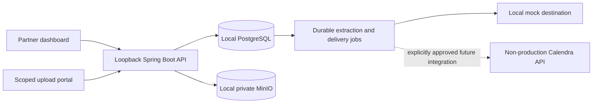

# Architecture

One Java 21 / Spring Boot 3 application and one React / TypeScript application. Profiles inject infrastructure configuration; domain logic stays shared.

Structured parsing is deterministic. Mock screenshot extraction is fixture based and makes no accuracy claim about real-world OCR. Review and validation precede approval; immutable snapshots precede delivery; per-record successful acknowledgments precede IMPORTED.

Opaque invitation tokens are hashed at rest and resolve scope on the server. Partner keys and sessions must never authorize requests for another partner. Property and tenant associations are constrained in the database and checked in application queries.
