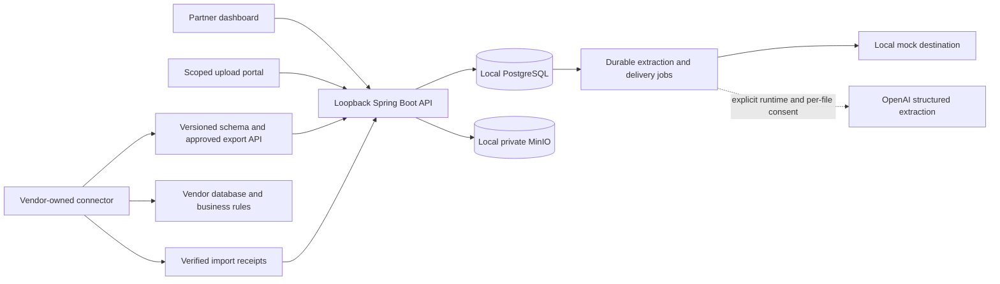

# Architecture

One Java 21 / Spring Boot 3 application and one React / TypeScript application. Profiles inject infrastructure configuration; domain logic stays shared.

Structured parsing is deterministic. Unknown or conflicting columns open for manual mapping, with optional bounded AI suggestions. Confirmed mappings apply to all source rows. Mock screenshot extraction is fixture based and makes no accuracy claim about real-world OCR. Authorized OpenAI images preserve source regions and uncertainty for human review. Review and validation precede immutable approval; per-record successful acknowledgments precede IMPORTED. The core contains no destination-specific adapter.

`ExportSchema` is the canonical field registry used by discovery, source mapping, sharing policies and projections. Full and selective exports read the same frozen snapshot and retain the same technical identities. Vendor consumers own target field transformations, catalog resolution, side effects and persistence. Optional partner catalogs validate supplied references; unresolved source labels can be exported for vendor-side resolution.

Opaque invitation tokens are hashed at rest and resolve scope on the server. Partner keys and sessions must never authorize requests for another partner. Property and tenant associations are constrained in the database and checked in application queries.
